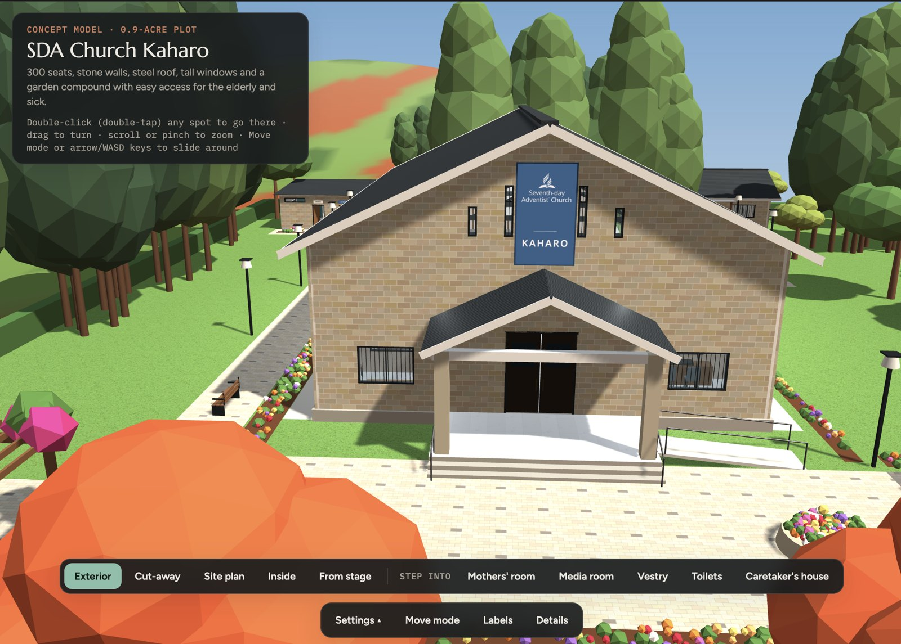

# SDA Church Kaharo: 3D concept model



An interactive 3D concept of a 300-seat Seventh-day Adventist church for Kaharo, on a 0.9-acre plot. It runs in any web browser and needs no install.

**Open it:** open `index.html` in a browser, or turn on GitHub Pages (Settings → Pages → Deploy from branch → `main` / root) to get a shareable link.

## Project structure

```
index.html            page markup
css/styles.css        all styles
js/app.js             the 3D scene, views, settings and controls
js/logo-data.js       SDA logo as an inline PNG (keeps the model working when opened from disk)
assets/               official logo files (SVG source and PNG)
```

## What's in the model

- **Main hall:** 16 × 28 m, 6 m walls, raked timber ceiling, 300 seats.
- **Stage:** 10 × 5.3 m, with:
  - an oak pulpit with a brass SDA logo
  - auditorium seats
  - a piano corner and a children's corner
  - a projector screen
- **Rooms:** mothers' room, media room, vestry, and a clerk's desk in the foyer.
- **Compound:**
  - a gate on the road side and one paved entrance
  - parking on both sides of the entrance
  - toilets with an accessible WC, and a rainwater tank
  - a caretaker's one-bedroom house
  - a resting garden
- **Accessibility:** ramps, a drop-off point, accessible parking, wheelchair spaces and handrails.

## Settings in the viewer

- **Lighting:** daylight only, or lights on
- **Seats:** benches or folding chairs
- **Windows:** standard or wide
- **Floor:** marble-look tiles or terrazzo

## Controls

| Action | How |
|---|---|
| Turn | Drag |
| Zoom | Scroll or pinch |
| Fly to any spot | Double-click or double-tap it |
| Slide across the site | Move mode, or W A S D / arrow keys (hold Shift to go faster) |

## Notes

- This is a concept for visualisation only. An architect, a structural engineer and county approval are needed before construction.
- The logo is the official SDA centered logo (TM version) from adventist.design. Its use follows the church's identity guidelines.
- Built with [three.js](https://threejs.org) r128, loaded from a CDN.
